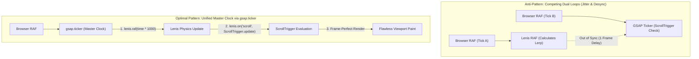

# Architecture Decision & Research: Lenis Smooth Scroll & GSAP ScrollTrigger Integration

**Project**: Wego-RB Landing Page (BPS Provinsi Sumatera Utara)  
**Issue Reference**: Resolves [#18](https://github.com/restusatrio11/Wego-RB/issues/18)  
**Branch**: `research/lenis-gsap-integration`  
**Status**: Resolved / Recommended Architecture Documented  

---

## Executive Summary

Smooth momentum scrolling and scroll-driven micro-interactions (staggered editorial typography reveals, parallax cards, pinned navigation highlights, and horizontal gallery scrubs) elevate the visual prestige of the **Wego-RB** landing page. However, haphazardly pairing modern inertial smooth scrolling with scroll animation engines frequently results in layout jitter, frame rate drops, mobile touch stutter, and broken trigger offsets when asynchronous data (such as Google Sheets GViz CMS rows and Google Drive thumbnails) expands the DOM.

This research resolves the integration architecture between **Lenis** (the modern smooth scroll library by Darkroom Engineering, formerly Studio Freight) and **GSAP ScrollTrigger** (GreenSock) in a **React 18** and **Vite 6** environment.

### Core Architectural Conclusions:

1. **Package Standard**: Use the modern `lenis` package (Darkroom Engineering, v1.1+) via its official `lenis/react` entry point (`ReactLenis`), combined with `gsap` (v3.12+) and `@gsap/react` (`useGSAP`). The older `@studio-freight/lenis` namespace is legacy and deprecated.
2. **Unified Master Ticker (Single Clock)**: Do **not** allow Lenis to run its own independent `requestAnimationFrame` loop. Configure Lenis with `autoRaf: false` and drive its updates through `gsap.ticker.add((time) => lenis.raf(time * 1000))`. Disable GSAP lag smoothing via `gsap.ticker.lagSmoothing(0)` to prevent rubber-banding or frame-skip snaps during momentum scrolling.
3. **The `scrollerProxy` Myth**: For standard viewport/window scrolling, **`ScrollTrigger.scrollerProxy` is NOT required and should NOT be used**. Lenis updates the native browser scroll position (`window.scrollY`), unlike legacy virtual-scroll libraries (such as Locomotive Scroll v4) that faked scrolling via CSS `transform: translate3d()`. Calling `scrollerProxy` on `window` with Lenis is an anti-pattern that introduces unnecessary overhead and desynchronization risks. `scrollerProxy` is strictly reserved for isolated nested scroll containers (`wrapper` / `content`).
4. **Bidirectional Height Synchronization**: When dynamic content loads (e.g. Google Sheets GViz seminar data, speaker headshots, accordion toggles), both Lenis's scroll boundary and ScrollTrigger's offset calculations must recalculate. Bind `ScrollTrigger.addEventListener('refresh', () => lenis.resize())`, and trigger an explicit `lenis.resize()` followed by `ScrollTrigger.refresh()` upon dynamic state resolution.
5. **React 18 Strict Mode Lifecycle Hygiene**: All GSAP ticker listeners and Lenis scroll listeners must be cleanly removed in `useEffect` cleanup callbacks, and animations must be scoped via `@gsap/react` `useGSAP()` to ensure seamless double-mounting resilience in React 18 and Vite Fast Refresh (HMR).

---

## 1. Primary Sources & Ecosystem Verification

All recommendations in this document are grounded in verified primary documentation, repository source code, and release notes:

| Primary Source | Canonical Reference / URL | Key Takeaways for Wego-RB |
| :--- | :--- | :--- |
| **Darkroom Engineering (Lenis)** | [github.com/darkroomengineering/lenis](https://github.com/darkroomengineering/lenis) | Rebranded from Studio Freight. Official React wrapper is integrated in monorepo at `lenis/react`. Recommends `lenis/dist/lenis.css`. |
| **GSAP ScrollTrigger Docs** | [gsap.com/docs/v3/Plugins/ScrollTrigger](https://gsap.com/docs/v3/Plugins/ScrollTrigger/) | Clarifies when `scrollerProxy` is required (transform containers only) vs native scroll interceptors. Official React hook is `@gsap/react`. |
| **Lenis React Package** | [darkroomengineering/lenis/packages/react](https://github.com/darkroomengineering/lenis/tree/main/packages/react) | Provides `<ReactLenis>` context provider and `useLenis()` hook. Supports `autoRaf: false` and `ref` access for ticker binding. |
| **GreenSock Forums & Architecture Guides** | [gsap.com/community](https://gsap.com/community/) | Explains why `gsap.ticker.lagSmoothing(0)` is mandatory with inertial scroll engines to avoid catching-up stutter. |

---

## 2. In-Depth Technical Analysis

### 2.1 The `requestAnimationFrame` (RAF) Synchronization Architecture

The most common failure pattern when integrating Lenis with GSAP is running **two competing animation loops**:
- Lenis runs its own internal `requestAnimationFrame` loop calculating physics and scroll positions.
- GSAP runs its internal `gsap.ticker` driving tween interpolation and ScrollTrigger checks.

When both loops run independently:
1. **Frame Race Conditions**: Lenis may update `window.scrollY` right *after* ScrollTrigger has already evaluated the frame, causing triggers to lag by 16.7ms (1 frame at 60fps) or 8.3ms (at 120fps). This produces perceptible micro-stuttering or jitter in scrubbed animations.
2. **Double Render Waste**: The browser executes two separate callbacks per refresh cycle, increasing thread utilization and draining mobile battery.



#### The Two Golden Rules of Ticker Synchronization:

1. **Unit Conversion (`time * 1000`)**:  
   `gsap.ticker` passes elapsed time in **seconds** (e.g., `0.01667`). Lenis's `.raf()` method expects time in **milliseconds** (e.g., `16.67`). Failing to multiply by 1000 causes Lenis's internal delta calculation to receive near-zero values, freezing smooth scrolling completely:
   ```javascript
   const update = (time) => {
     lenisRef.current?.lenis?.raf(time * 1000); // CRITICAL: seconds to ms
   };
   gsap.ticker.add(update);
   ```

2. **Lag Smoothing Disabled (`gsap.ticker.lagSmoothing(0)`)**:  
   By default, GSAP features "lag smoothing" (e.g. `lagSmoothing(500, 33)`). When the CPU experiences a momentary stall (such as during image decoding or garbage collection), GSAP artificially slows down or skips virtual time to prevent animations from jumping ahead violently.  
   However, with momentum smooth scroll, lag smoothing causes a noticeable "rubber-band snap" where scrolling briefly freezes and then leaps forward to catch up. Setting `gsap.ticker.lagSmoothing(0)` turns off this behavior, ensuring buttery-smooth inertial motion even under intermittent CPU load.

---

### 2.2 Dispelling the `ScrollTrigger.scrollerProxy` Myth

Developers familiar with older smooth scrolling libraries (Locomotive Scroll v4, ASScroll, SmoothScrollbar) often assume that `ScrollTrigger.scrollerProxy` is an obligatory boilerplate step for any smooth scrolling website.

**This is incorrect for Lenis.**

#### Why Legacy Libraries Needed `scrollerProxy`:
Legacy libraries completely hijacked the document flow. They set `body { overflow: hidden; height: 100vh; }` and moved the entire website markup inside a `<div id="scroll-container">` using CSS 3D transforms:
```css
/* Legacy Smooth Scroll Transform (e.g., Locomotive Scroll v4) */
#scroll-container {
  transform: translate3d(0px, -1420px, 0px);
}
```
Because the browser's native window remained stationary at `window.scrollY === 0`, GSAP ScrollTrigger had no native scroll events or scroll position to inspect. `ScrollTrigger.scrollerProxy` was required to intercept GSAP's scroll position queries and redirect them to the library's virtual transform coordinates.

#### Why Lenis Does NOT Need `scrollerProxy` on Window:
Lenis uses **native browser scroll**. It intercepts user input gestures (wheel, touch, arrow keys), applies an easing/lerp formula to calculate momentum, and then smoothly updates the native viewport scroll:
- `window.scrollY` actually changes.
- Native `window.addEventListener('scroll', ...)` fires.
- Standard CSS `position: sticky` and `position: fixed` continue to work natively without transform-breaking bugs.

Because native scroll is updated, ScrollTrigger natively understands where the page is! All that is needed is notifying ScrollTrigger immediately when Lenis interpolates a frame:
```javascript
lenis.on('scroll', ScrollTrigger.update);
```

#### When IS `scrollerProxy` Needed with Lenis?
The *only* scenario where `ScrollTrigger.scrollerProxy` is necessary with Lenis is when Lenis is scoped to a **custom nested scroll container** (`wrapper` + `content` options) rather than the global `window`:

```javascript
// ONLY required for nested overflow containers, NEVER for window/root:
const scrollerElement = document.querySelector('.nested-scroll-modal');

ScrollTrigger.scrollerProxy(scrollerElement, {
  scrollTop(value) {
    if (arguments.length) {
      lenisInstance.scrollTo(value, { immediate: true });
    }
    return lenisInstance.scroll;
  },
  getBoundingClientRect() {
    return {
      top: 0,
      left: 0,
      width: window.innerWidth,
      height: window.innerHeight
    };
  },
  pinType: scrollerElement.style.transform ? "transform" : "fixed"
});
```

> [!IMPORTANT]
> For the Wego-RB landing page (and all standard full-page web applications), Lenis runs at the root viewport level. **Do not define `ScrollTrigger.scrollerProxy` for window/body.** Doing so adds redundant wrapper overhead and can cause coordinate desynchronization with mobile browser address bars.

---

### 2.3 React 18 & Vite 6 Lifecycle: Strict Mode & Cleanup

React 18 introduces Concurrent Rendering and enforces **Strict Mode** in development, which automatically unmounts and remounts components (`mount -> unmount -> mount`) to verify effect cleanup resilience. Additionally, Vite 6's lightning-fast Hot Module Replacement (HMR) replaces modules on the fly.

If smooth scroll and GSAP tickers are not cleaned up properly:
- Ticker functions multiply on every HMR save, causing exponential CPU load.
- Stale event listeners reference unmounted DOM nodes, triggering memory leaks.
- ScrollTrigger start/end marker calculations become corrupt.

#### Teardown Checklist for React 18:
1. **Remove Ticker Listener**: `gsap.ticker.remove(tickerUpdateFunction)`
2. **Remove Scroll Listener**: `lenis.off('scroll', ScrollTrigger.update)`
3. **Revert GSAP Context**: Use `@gsap/react` `useGSAP()` or clean up via `ctx.revert()` so all tweens, timelines, and trigger pins are safely detached.
4. **Destroy Lenis Instance**: When unmounting the root provider, call `lenis.destroy()`.

---

### 2.4 Handling Dynamic Content Height Updates

In the Wego-RB landing page, layout dimensions are not static at initial HTML render time:
1. **Google Sheets GViz API**: Seminar schedules (`Seminars.csv`), speaker cards (`Speakers.csv`), and site settings load asynchronously over the network.
2. **Google Drive Thumbnails**: Flyer graphics and speaker portraits load over Google Drive edge endpoints (`lh3.googleusercontent.com` / `drive.google.com/thumbnail`).
3. **Interactive UI Elements**: Seminar detail modals open, accordions expand, and filtering tabs show/hide content blocks.

If the page height expands from 2,000px to 4,800px after data loads, but Lenis and ScrollTrigger retain their initial measurements:
- Lenis clamps scrolling at 2,000px, preventing users from reaching the bottom of the page.
- ScrollTrigger pins and markers fire at obsolete offsets, ruining animations.

#### The Two-Way Synchronization Solution:

1. **Bind ScrollTrigger Refresh to Lenis Resize**:
   Ensure Lenis recalculates its max scroll bounds whenever ScrollTrigger refreshes:
   ```javascript
   ScrollTrigger.addEventListener('refresh', () => lenis.resize());
   ```

2. **Trigger Explicit Height Refresh After Asynchronous Operations**:
   Whenever dynamic state updates (e.g. `data` fetched from Google Sheets or image batch loaded):
   ```javascript
   export function refreshScrollLayout(lenis) {
     if (lenis) {
       lenis.resize();
     }
     ScrollTrigger.refresh();
   }
   ```

3. **Use CSS Aspect Ratios for Images**:
   Prevent layout shifts before images load by enforcing explicit aspect ratios (e.g., `aspect-[3/4]` for portrait posters, `aspect-video` for slides). This ensures the DOM occupies full height immediately, preventing layout jumps when images finish downloading.

4. **Add `invalidateOnRefresh: true` on Dynamic GSAP Animations**:
   For any ScrollTrigger animation that computes coordinates dynamically (e.g., responsive offsets or width-dependent values), specify `invalidateOnRefresh: true` in the ScrollTrigger configuration:
   ```javascript
   gsap.to(element, {
     x: () => -1 * (container.scrollWidth - window.innerWidth),
     ease: "none",
     scrollTrigger: {
       trigger: container,
       pin: true,
       scrub: 1,
       invalidateOnRefresh: true, // Recalculates dynamically on layout resize!
     }
   });
   ```

---

## 3. Recommended Production Code Blueprints

Below are the production-ready code patterns recommended for implementation in the Wego-RB codebase.

### Blueprint A: `SmoothScrollProvider.jsx` (Root Provider)

This component wraps the entire landing page. It initializes `ReactLenis`, mounts `lenis/dist/lenis.css`, hooks the RAF loop into `gsap.ticker`, and cleans up on unmount.

```jsx
// src/components/layout/SmoothScrollProvider.jsx
import React, { useEffect, useRef } from 'react';
import { ReactLenis } from 'lenis/react';
import { gsap } from 'gsap';
import { ScrollTrigger } from 'gsap/ScrollTrigger';

// Import official Lenis stylesheet to handle html/body scrolling behavior
import 'lenis/dist/lenis.css';

// Register GSAP ScrollTrigger plugin once at root
gsap.registerPlugin(ScrollTrigger);

export function SmoothScrollProvider({ children }) {
  const lenisRef = useRef(null);

  useEffect(() => {
    const lenis = lenisRef.current?.lenis;
    if (!lenis) return;

    // 1. Tell ScrollTrigger to recalculate on every Lenis smooth-scroll tick
    const handleScroll = () => {
      ScrollTrigger.update();
    };
    lenis.on('scroll', handleScroll);

    // 2. Drive Lenis through GSAP's central master ticker
    const handleTicker = (time) => {
      // GSAP provides time in seconds, Lenis expects milliseconds
      lenis.raf(time * 1000);
    };
    gsap.ticker.add(handleTicker);

    // 3. Disable GSAP lag smoothing to eliminate inertial rubber-banding
    gsap.ticker.lagSmoothing(0);

    // 4. Two-way height sync: recalculate Lenis limits whenever ScrollTrigger refreshes
    const handleRefresh = () => {
      lenis.resize();
    };
    ScrollTrigger.addEventListener('refresh', handleRefresh);

    // Strict Mode & unmount cleanup
    return () => {
      lenis.off('scroll', handleScroll);
      gsap.ticker.remove(handleTicker);
      ScrollTrigger.removeEventListener('refresh', handleRefresh);
    };
  }, []);

  return (
    <ReactLenis
      root
      ref={lenisRef}
      autoRaf={false} // CRITICAL: Driven by gsap.ticker instead of internal loop
      options={{
        lerp: 0.1,             // Smoothing intensity (0.1 = luxurious momentum)
        duration: 1.2,         // Duration of scroll animation
        smoothWheel: true,     // Enable smooth scrolling for mouse wheels
        syncTouch: false,      // Preserve native touch feel on mobile devices
        wheelMultiplier: 1.0,  // Standard wheel speed
        touchMultiplier: 1.5,
      }}
    >
      {children}
    </ReactLenis>
  );
}

export default SmoothScrollProvider;
```

---

### Blueprint B: Dynamic Content Height Hook (`useDynamicScrollRefresh.js`)

This custom hook watches asynchronous data (such as Google Sheets GViz query results or dynamic image loading) and safely recalibrates Lenis and ScrollTrigger.

```javascript
// src/hooks/useDynamicScrollRefresh.js
import { useEffect } from 'react';
import { useLenis } from 'lenis/react';
import { ScrollTrigger } from 'gsap/ScrollTrigger';

/**
 * Triggers a layout recalculation for Lenis and ScrollTrigger
 * when dynamic dependencies (e.g., fetched seminar data) change.
 * 
 * @param {Array} dependencies - React dependency array (e.g., [seminars, speakers])
 * @param {number} delayMs - Optional debounce/delay to allow CSS transitions to finish
 */
export function useDynamicScrollRefresh(dependencies = [], delayMs = 100) {
  const lenis = useLenis();

  useEffect(() => {
    // Wait for the DOM to settle after state updates
    const timer = setTimeout(() => {
      if (lenis) {
        lenis.resize();
      }
      ScrollTrigger.refresh();
    }, delayMs);

    return () => clearTimeout(timer);
  }, [lenis, ...dependencies]);
}

export default useDynamicScrollRefresh;
```

---

### Blueprint C: Animated Section with `@gsap/react` `useGSAP`

This component demonstrates how child sections in Wego-RB (e.g. Hero, Sesi Seminar, Wegoers profiles) implement scroll-triggered entrance animations with proper scoping and zero memory leaks.

```jsx
// src/components/sections/EditorialHeroReveal.jsx
import React, { useRef } from 'react';
import { gsap } from 'gsap';
import { useGSAP } from '@gsap/react';
import { ScrollTrigger } from 'gsap/ScrollTrigger';

gsap.registerPlugin(ScrollTrigger);

export function EditorialHeroReveal({ title, subtitle }) {
  const containerRef = useRef(null);

  useGSAP(
    () => {
      // Staggered reveal for headline words
      gsap.from('.reveal-item', {
        y: 40,
        opacity: 0,
        duration: 1.0,
        stagger: 0.15,
        ease: 'power3.out',
        scrollTrigger: {
          trigger: containerRef.current,
          start: 'top 80%',
          toggleActions: 'play none none reverse',
        },
      });

      // Subtle parallax on decorative badge
      gsap.to('.hero-badge', {
        y: -30,
        ease: 'none',
        scrollTrigger: {
          trigger: containerRef.current,
          start: 'top bottom',
          end: 'bottom top',
          scrub: true,
        },
      });
    },
    { scope: containerRef } // Scoped cleanup: automatically reverts on unmount!
  );

  return (
    <section ref={containerRef} className="py-24 px-6 md:px-14 border-b border-neutral-200">
      <div className="max-w-5xl">
        <span className="hero-badge inline-block mb-4 px-3 py-1 text-xs uppercase tracking-widest font-mono bg-neutral-100 border border-neutral-200">
          Inovasi BPS Sumut
        </span>
        <h1 className="font-display italic text-4xl md:text-6xl text-neutral-900 leading-tight">
          <span className="reveal-item block">{title}</span>
        </h1>
        <p className="reveal-item mt-6 text-neutral-600 text-lg md:text-xl font-sans max-w-2xl">
          {subtitle}
        </p>
      </div>
    </section>
  );
}

export default EditorialHeroReveal;
```

---

### Blueprint D: Smooth Anchor Navigation Helper

When users click header anchors (e.g. `#seminar`, `#profiles`, `#ads`), native browser jumping can conflict with Lenis momentum. This helper leverages Lenis's built-in `scrollTo` method with an editorial easing curve and header offset:

```javascript
// src/utils/scrollNavigation.js
/**
 * Smoothly scrolls to a target DOM selector or pixel offset using Lenis.
 * 
 * @param {import('lenis').default} lenisInstance - The active Lenis instance from useLenis()
 * @param {string | HTMLElement | number} target - CSS selector (e.g., '#seminar') or element
 * @param {Object} options - Navigation options
 */
export function navigateToSection(lenisInstance, target, options = {}) {
  if (!lenisInstance) {
    // Fallback to native smooth scroll if Lenis is unavailable
    if (typeof target === 'string') {
      const el = document.querySelector(target);
      el?.scrollIntoView({ behavior: 'smooth' });
    }
    return;
  }

  lenisInstance.scrollTo(target, {
    offset: options.offset ?? -80, // Offset for sticky top navigation bar
    duration: options.duration ?? 1.4,
    easing: (t) => Math.min(1, 1.001 - Math.pow(2, -10 * t)), // Exponential ease-out
    immediate: false,
    ...options,
  });
}
```

---

## 4. Performance, Accessibility, and Mobile UX Considerations

### 4.1 Accessibility: `prefers-reduced-motion`
Users with vestibular disorders or motion sensitivities often configure their operating system to reduce motion (`prefers-reduced-motion: reduce`). Respecting this preference is essential for public sector BPS applications.

Lenis can detect this setting and bypass smooth scrolling:
```javascript
const prefersReducedMotion = window.matchMedia('(prefers-reduced-motion: reduce)').matches;

const lenisOptions = {
  duration: prefersReducedMotion ? 0 : 1.2,
  smoothWheel: !prefersReducedMotion,
  syncTouch: false,
};
```
Furthermore, in GSAP:
```javascript
if (prefersReducedMotion) {
  ScrollTrigger.config({ autoRefreshEvents: "visibilitychange,DOMContentLoaded,load" });
}
```

### 4.2 Mobile Touch Devices: `syncTouch` vs Native Scroll
Touch devices (iOS Safari, Android Chrome) already feature hardware-accelerated momentum scrolling with inertia and rubber-banding.
- Setting `syncTouch: true` forces Lenis to intercept mobile touch events. While this creates a consistent feel across desktop and mobile, on low-tier mobile devices it can cause perceived lag or conflict with Safari's collapsing URL address bar.
- **Recommendation**: Set `syncTouch: false` (default) for mobile. Let mobile devices use native inertial scroll. Lenis's scroll listeners will still observe native touch scrolling and keep ScrollTrigger synchronized without hijacking native touch physics.

### 4.3 Bundle Impact
- `lenis`: ~3.8 kB minified & gzipped.
- `gsap` + `ScrollTrigger` + `@gsap/react`: ~24 kB minified & gzipped.
Combined with the zero-dependency Google Sheets GViz architecture documented in [#3](https://github.com/restusatrio11/Wego-RB/issues/3), the total interactive footprint of Wego-RB remains exceptionally lean (< 35 kB gzip total interactive overhead), well within high-performance web vitals targets.

---

## 5. Comparative Evaluation Summary

| Architecture Dimension | Anti-Pattern / Naive Setup | Recommended Wego-RB Standard |
| :--- | :--- | :--- |
| **Package** | `@studio-freight/lenis` (deprecated) | `lenis` + `lenis/react` (v1.1+) |
| **Animation Loop** | Competing dual RAF loops (`autoRaf: true` + GSAP RAF) | **Unified Master Ticker** via `gsap.ticker.add()` (`autoRaf: false`) |
| **Time Units** | Passing seconds directly (`lenis.raf(time)`) -> *Freezes scroll* | **Explicit millisecond conversion** (`lenis.raf(time * 1000)`) |
| **Lag Compensation** | Default GSAP lag smoothing (`lagSmoothing(500, 33)`) -> *Jitter* | **Disabled lag smoothing** (`gsap.ticker.lagSmoothing(0)`) |
| **Scroller Proxy** | Applying `ScrollTrigger.scrollerProxy(window, ...)` | **No scrollerProxy on window** (Lenis uses native window scroll) |
| **Dynamic Content** | Static trigger calculation -> *Misaligned triggers on data fetch* | **Bidirectional resize** (`lenis.resize()` + `ScrollTrigger.refresh()`) |
| **React 18 Lifecycle** | Ad-hoc `useEffect` without cleanup -> *Memory leaks & HMR churn* | **Strict Mode hygiene** + `@gsap/react` `useGSAP()` scoped cleanup |
| **Image Loading** | Unconstrained layout shifts upon image download | **CSS aspect ratio containment** (`aspect-[3/4]`, `aspect-video`) |
| **Accessibility** | Hardcoded momentum scroll forcing movement | **`prefers-reduced-motion` compliance** |

---

## 6. Implementation Checklist for Wego-RB

When executing UI feature tickets involving Lenis and GSAP in Wego-RB, apply the following steps:

- [ ] Install packages: `npm i lenis gsap @gsap/react`
- [ ] Import `lenis/dist/lenis.css` in root layout or `main.jsx`
- [ ] Wrap app root in `SmoothScrollProvider.jsx` with `autoRaf={false}` and `gsap.ticker` binding
- [ ] Ensure `ScrollTrigger.scrollerProxy` is **NOT** configured for window
- [ ] Register `ScrollTrigger.addEventListener('refresh', () => lenis.resize())`
- [ ] Call `lenis.resize()` and `ScrollTrigger.refresh()` after Google Sheets GViz data resolves in `useSeminars` / `useSpeakers` hooks
- [ ] Use `useGSAP({ scope: containerRef })` for all editorial section animations
- [ ] Verify test suite passes (`npm test`) without breaking existing JSDOM test environments (guarding window/DOM calls in mockable utilities)
